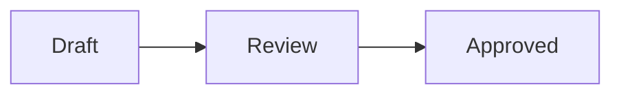

## تحويل Mermaid إلى PDF

الصق شيفرة Mermaid في المحرر، أو أسقط ملف `.mmd` عليه، أو اختر **فتح ملف**. يمكنك أيضًا لصق كتلة شيفرة `mermaid` واحدة محاطة بعلامات التحديد من مستند Markdown. تحقق من المعاينة، وحدد حجم الصفحة، ثم اختر **تنزيل PDF**. يتم إنشاء الرسم التخطيطي وملف PDF في متصفحك.

لتجربته باستخدام مخطط انسيابي، اختر **تحميل مثال** أو الصق مخطط الموافقة التالي، الذي يرتب الخطوات من اليسار إلى اليمين.

## اختر حجم الصفحة للمشاركة أو الطباعة

**ملاءمة حجم المخطط** يجعل صفحة PDF واحدة بحجم الرسم التخطيطي بأكمله. اختر **A4** أو **US Letter** لملاءمة الرسم التخطيطي داخل صفحة قياسية بها هوامش. تتحول الصفحة إلى الوضع الأفقي للحصول على مخططات واسعة. قد تصبح تسميات المخطط الانسيابي الكبير صغيرة عند ملاءمته للورق، لذا استخدم **ملاءمة حجم المخطط** عندما يعرض القارئ ملف PDF على الشاشة ويقوم بتكبيره.

## PDF متجهي أو SVG

يحافظ PDF على الأشكال المتجهة للمخطط بحيث تظل الخطوط والأسهم واضحة عند التكبير/التصغير العالي. استخدمه لتقرير أو نشرة أو مرفق. قم بتنزيل **SVG** لتضمين الرسم التخطيطي في صفحة ويب أو فتحه في محرر رسومات متجهية. احتفظ بشيفرة Mermaid الأصلية لتحديث الرسم التخطيطي لاحقًا. للتحرير العادي وتصدير PNG، استخدم [معاين Mermaid](../mermaid-previewer/).

تُحفظ تسميات المخطط كمسارات متجهية. ارجع إلى الملف الأصلي لنسخ نص التسميات أو تعديله.

## إصلاح الرسم التخطيطي الذي لن يتم عرضه

ابدأ بإعلان رسم تخطيطي مثل `flowchart LR` أو `sequenceDiagram`. إذا كانت الشيفرة من Markdown، فالصق كتلة Mermaid وحدها. يحتفظ المحول بشيفرتك عند فشل العرض، حتى تتمكن من إصلاح بناء الجملة والمحاولة مرة أخرى. راجع [مرجع بناء الجملة Mermaid](https://mermaid.js.org/intro/syntax-reference.html) لمزيد من أنواع المخططات.
