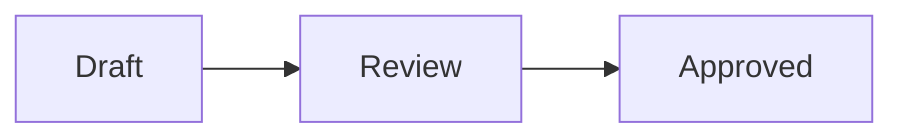

## Mermaid in PDF umwandeln

Füge Mermaid-Code in den Editor ein, lege dort eine `.mmd`-Datei ab oder wähle **Datei öffnen**. Aus einem Markdown-Dokument kannst du einen einzelnen `mermaid`-Codeblock übernehmen. Prüfe die Vorschau, wähle ein Seitenformat und klicke auf **PDF herunterladen**. Das Diagramm und die PDF-Datei werden in deinem Browser erstellt.

Wähle **Beispiel laden** oder füge dieses Freigabe-Flussdiagramm ein. Es ordnet die Schritte von links nach rechts an.

## Ein Seitenformat zum Teilen oder Drucken wählen

**An Diagramm anpassen** erstellt eine Seite in der Größe des ganzen Diagramms. Mit **A4** oder **US Letter** passt es samt Seitenrändern auf ein Standardblatt. Breite Diagramme werden im Querformat ausgegeben. Nutze **An Diagramm anpassen** für große Flussdiagramme, deren Beschriftungen auf einem Standardblatt zu klein wären. Am Bildschirm lassen sie sich dann gut vergrößern.

## Vektor-PDF oder SVG wählen

Im PDF bleiben die Formen als Vektoren erhalten. Linien und Pfeile sind auch bei starker Vergrößerung scharf. Das PDF eignet sich für Berichte, Handouts und Anhänge. Lade **SVG** herunter, um das Diagramm in eine Webseite einzubetten oder im Vektoreditor zu öffnen. Bewahre zum späteren Bearbeiten den Mermaid-Code auf. Für regelmäßige Änderungen und den PNG-Export gibt es die [Mermaid-Vorschau](../mermaid-previewer/).

Beschriftungen werden als Vektorkonturen gespeichert. Nutze die Quelldatei, um den Beschriftungstext zu kopieren oder zu bearbeiten.

## Fehler beheben, wenn kein Diagramm erscheint

Beginne mit einem Diagrammtyp wie `flowchart LR` oder `sequenceDiagram`. Füge aus einem Markdown-Dokument nur den Mermaid-Codeblock ein. Der Editor behält deinen Code bei einem Fehler, damit du die Syntax korrigieren kannst. Weitere Diagrammtypen findest du in der [Mermaid-Syntaxreferenz](https://mermaid.js.org/intro/syntax-reference.html).
