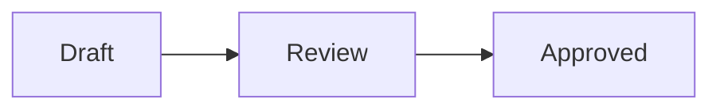

## Convert Mermaid to PDF

Paste Mermaid code into the editor, drop a `.mmd` file onto it, or choose **Open file**. You can also paste a single fenced `mermaid` block from a Markdown document. Check the preview, select a page size, and choose **Download PDF**. The diagram and the PDF are generated in your browser.

To try it with a flowchart, choose **Load an example** or paste this approval flow. It lays the steps out from left to right.

## Choose a page size for sharing or printing

**Fit to diagram** makes one PDF page sized to the entire diagram. Choose **A4** or **US Letter** to fit the diagram inside a standard page with margins. The page turns to landscape for wide diagrams. A large flowchart can have small labels when fitted to paper, so use **Fit to diagram** when your reader will view the PDF on screen and zoom in.

## Vector PDF or SVG

PDF preserves the diagram's vector shapes so lines and arrows stay sharp at high zoom. Use it for a report, handout, or attachment. Download **SVG** to embed the diagram in a web page or open it in a vector editor. Keep the original Mermaid code to update the diagram later. For regular editing and PNG export, use the [Mermaid Previewer](../mermaid-previewer/).

The PDF stores labels as vector outlines. Use the source file to copy or edit the label text.

## Fix a diagram that will not render

Start with a diagram declaration such as `flowchart LR` or `sequenceDiagram`. If the code came from Markdown, paste the Mermaid block by itself. The converter keeps your code when a render fails, so you can fix the syntax and try again. See the [Mermaid syntax reference](https://mermaid.js.org/intro/syntax-reference.html) for more diagram types.
