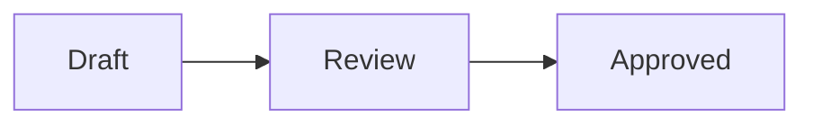

## Convertir Mermaid a PDF

Pega código Mermaid en el editor, arrastra allí un archivo `.mmd` o elige **Abrir archivo**. También puedes pegar un solo bloque de código `mermaid` de un documento Markdown. Revisa la vista previa, elige un tamaño de página y pulsa **Descargar PDF**. El diagrama y el PDF se generan en tu navegador.

Elige **Cargar un ejemplo** o pega este flujo de aprobación. Los pasos se muestran de izquierda a derecha.

## Elegir un tamaño de página para compartir o imprimir

**Ajustar al diagrama** crea una página del tamaño del diagrama completo. Elige **A4** o **Carta (EE. UU.)** para ajustarlo a una hoja estándar con márgenes. Los diagramas anchos se colocan en horizontal. Si un diagrama grande queda con texto pequeño en papel, usa **Ajustar al diagrama** para que pueda ampliarse en pantalla.

## PDF vectorial o SVG

El PDF conserva las formas vectoriales del diagrama. Las líneas y flechas se mantienen nítidas al ampliar, lo que resulta útil para informes, material impreso o archivos adjuntos. Descarga **SVG** para insertar el diagrama en una página web o abrirlo en un editor vectorial. Guarda el código Mermaid si quieres modificarlo más adelante. Para editarlo con frecuencia o exportarlo en PNG, usa la [Vista previa de Mermaid](../mermaid-previewer/).

Las etiquetas se guardan como contornos vectoriales. Usa el archivo de origen para copiar o editar su texto.

## Qué hacer si no se dibuja el diagrama

Empieza con una declaración como `flowchart LR` o `sequenceDiagram`. Si el código procede de Markdown, pega solo el bloque Mermaid. Si el diagrama no se dibuja, el código se conserva para que puedas corregirlo. Consulta otros tipos de diagrama en la [referencia de sintaxis de Mermaid](https://mermaid.js.org/intro/syntax-reference.html).
