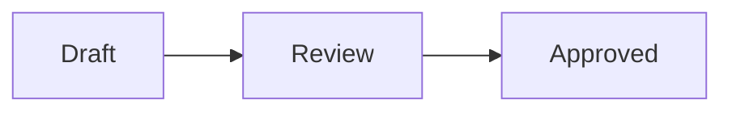

## המר Mermaid ל-PDF

הדביקו קוד Mermaid בעורך, גררו אליו קובץ `.mmd` או בחרו **פתיחת קובץ**. ניתן גם להדביק בלוק קוד `mermaid` יחיד עם סימני הפתיחה והסגירה ממסמך Markdown. בדוק את התצוגה המקדימה, בחר גודל עמוד ובחר **הורדת PDF**. התרשים וה-PDF נוצרים בדפדפן שלך.

כדי לנסות תרשים זרימה, בחרו **טעינת דוגמה** או הדביקו את תהליך האישור הבא, שמציג את השלבים משמאל לימין.

## בחר גודל עמוד לשיתוף או הדפסה

**התאמה לתרשים** יוצר עמוד PDF אחד בגודל של הדיאגרמה כולה. בחר **A4** או **US Letter** כדי להתאים את הדיאגרמה לדף רגיל עם שוליים. העמוד פונה לרוחב עבור דיאגרמות רחבות. תרשים זרימה גדול יכול לכלול תוויות קטנות כאשר הוא מותאם לדף, אז השתמש ב-**התאמה לתרשים** כשהקוראים יצפו ב-PDF על המסך ויגדילו אותו.

## PDF וקטורי או SVG

PDF משמר את הצורות הווקטוריות של הדיאגרמה כך שקווים וחצים נשארים חדים בזום גבוה. השתמש בו עבור דוח, דפי מידע או קובץ מצורף. הורד את **SVG** כדי להטביע את הדיאגרמה בדף אינטרנט או פתח אותו בעורך גרפי וקטורי. שמור את קוד Mermaid המקורי כדי לעדכן את הדיאגרמה מאוחר יותר. עבור עריכה רגילה ויצוא PNG, השתמש ב-[תצוגה מקדימה של Mermaid](../mermaid-previewer/).

הכיתובים נשמרים כקווי מתאר וקטוריים. להעתקה או לעריכה של הטקסט, השתמשו בקובץ המקור.

## תקן תרשים שלא יוצג

התחל עם הצהרת דיאגרמה כגון `flowchart LR` או `sequenceDiagram`. אם הקוד הגיע מ-Markdown, הדביקו רק את בלוק Mermaid. הממיר שומר את הקוד שלך כאשר רינדור נכשל, כך שתוכל לתקן את התחביר ולנסות שוב. ראה [מדריך התחביר של Mermaid](https://mermaid.js.org/intro/syntax-reference.html) לסוגי דיאגרמות נוספים.
