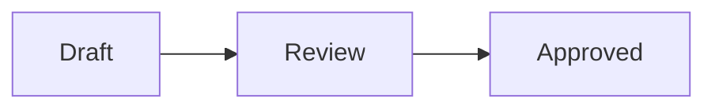

## Mermaid को PDF में बदलें

संपादक में Mermaid कोड चिपकाएँ, उस पर एक `.mmd` फ़ाइल छोड़ें, या **फ़ाइल खोलें** चुनें। आप Markdown दस्तावेज़ से फ़ेंस में रखा एक `mermaid` कोड ब्लॉक को भी चिपका सकते हैं। पूर्वावलोकन जांचें, पृष्ठ आकार चुनें और **PDF डाउनलोड करें** चुनें। आरेख और PDF आपके ब्राउज़र में उत्पन्न होते हैं।

फ़्लोचार्ट के साथ इसे आज़माने के लिए, **उदाहरण लोड करें** चुनें या इस अनुमोदन फ़्लो को पेस्ट करें। इसमें चरण बाएँ से दाएँ दिखते हैं।

## साझा करने या मुद्रण के लिए एक पृष्ठ आकार चुनें

**डायग्राम के अनुसार फ़िट करें** एक PDF पृष्ठ को संपूर्ण आरेख के आकार का बनाता है। हाशिये वाले मानक पृष्ठ के अंदर आरेख को फ़िट करने के लिए **A4** या **US Letter** चुनें। चौड़े डायग्राम के लिए पेज लैंडस्केप दिशा में होता है। एक बड़े फ़्लोचार्ट को कागज़ पर फिट करने पर छोटे लेबल हो सकते हैं, इसलिए जब आपका पाठक PDF को स्क्रीन पर देखेगा और ज़ूम इन करेगा तो **डायग्राम के अनुसार फ़िट करें** का उपयोग करें।

## वेक्टर PDF या SVG

PDF आरेख के वेक्टर आकार को संरक्षित करता है ताकि रेखाएं और तीर उच्च ज़ूम पर स्पष्ट रहें। इसका उपयोग किसी रिपोर्ट, हैंडआउट या अनुलग्नक के लिए करें। किसी वेब पेज में आरेख को एम्बेड करने या वेक्टर संपादक में खोलने के लिए **SVG** डाउनलोड करें। डायग्राम को बाद में अपडेट करने के लिए मूल Mermaid कोड रखें। नियमित संपादन और PNG निर्यात के लिए, [Mermaid प्रीव्यूअर](../mermaid-previewer/) का उपयोग करें।

लेबल वेक्टर आउटलाइन के रूप में सहेजे जाते हैं। लेबल का टेक्स्ट कॉपी करने या बदलने के लिए स्रोत फ़ाइल का उपयोग करें।

## रेंडर न होने वाला डायग्राम ठीक करें

`flowchart LR` या `sequenceDiagram` जैसी आरेख घोषणा से प्रारंभ करें। यदि कोड मार्कडाउन से आया है, तो केवल Mermaid ब्लॉक पेस्ट करें। रेंडर विफल होने पर कनवर्टर आपका कोड रखता है, ताकि आप सिंटैक्स को ठीक कर सकें और पुनः प्रयास कर सकें। अधिक आरेख प्रकारों के लिए [Mermaid सिंटैक्स संदर्भ](https://mermaid.js.org/intro/syntax-reference.html) देखें।
