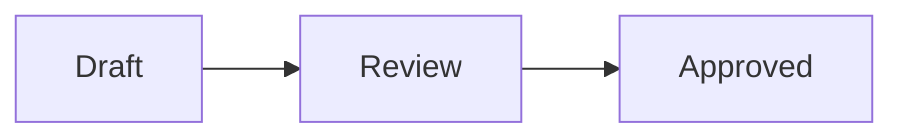

## Ubah Mermaid menjadi PDF

Tempel kode Mermaid di editor, seret file `.mmd` ke editor, atau pilih **Buka file**. Anda juga bisa menempel satu blok kode berpagar `mermaid` dari dokumen Markdown. Periksa pratinjau, pilih ukuran halaman, lalu klik **Unduh PDF**. Diagram dan PDF dibuat di browser.

Untuk mencoba diagram alir, pilih **Muat contoh** atau tempel kode alur persetujuan ini. Langkah-langkahnya tersusun dari kiri ke kanan.

## Pilih ukuran halaman untuk berbagi atau mencetak

**Sesuaikan dengan diagram** membuat satu halaman PDF seukuran diagram lengkap. Pilih **A4** atau **US Letter** untuk memuat diagram pada halaman standar dengan margin. Diagram lebar memakai orientasi lanskap. Label pada diagram alir besar bisa terlihat kecil saat disesuaikan dengan kertas. Gunakan **Sesuaikan dengan diagram** jika pembaca akan memperbesar PDF di layar.

## PDF vektor atau SVG

PDF mempertahankan bentuk vektor agar garis dan panah tetap tajam saat diperbesar. Gunakan PDF untuk laporan, materi cetak, atau lampiran. Unduh **SVG** untuk menyematkan diagram di halaman web atau membukanya di editor vektor. Simpan kode Mermaid asli untuk mengubah diagram nanti. Untuk mengedit dan mengunduh PNG, gunakan [Pratinjau Mermaid](../mermaid-previewer/).

Label disimpan sebagai garis bentuk vektor. Gunakan berkas sumber untuk menyalin atau menyunting teks label.

## Perbaiki diagram yang gagal ditampilkan

Awali dengan deklarasi diagram seperti `flowchart LR` atau `sequenceDiagram`. Jika kode berasal dari Markdown, tempel blok Mermaid saja. Konverter mempertahankan kode ketika diagram gagal ditampilkan, sehingga Anda bisa memperbaiki sintaks dan mencoba lagi. Lihat [referensi sintaks Mermaid](https://mermaid.js.org/intro/syntax-reference.html) untuk jenis diagram lain.
