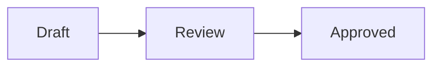

## Convertire da Mermaid a PDF

Incolla il codice Mermaid nell’editor, trascinaci un file `.mmd` oppure scegli **Apri file**. Puoi anche incollare un singolo blocco di codice `mermaid` tratto da un documento Markdown. Controlla l’anteprima, scegli il formato della pagina e fai clic su **Scarica PDF**. Il diagramma e il PDF vengono generati nel browser.

Scegli **Carica un esempio** oppure incolla questo flusso di approvazione. I passaggi vengono disposti da sinistra a destra.

## Scegliere un formato per la condivisione o la stampa

**Adatta al diagramma** crea una pagina delle dimensioni del diagramma completo. Scegli **A4** o **Lettera USA** per farlo rientrare in un foglio standard con margini. I diagrammi larghi vengono disposti in orizzontale. Se i testi di un diagramma grande diventano troppo piccoli per la stampa, scegli **Adatta al diagramma** per leggerli ingrandendo il PDF sullo schermo.

## PDF vettoriale o SVG

Il PDF conserva le forme vettoriali del diagramma. Linee e frecce restano nitide anche con un forte ingrandimento, per esempio in relazioni, materiali da distribuire e allegati. Scarica il file **SVG** per inserire il diagramma in una pagina web o aprirlo in un editor vettoriale. Conserva il codice Mermaid per modificarlo in seguito. Per modifiche frequenti e l’esportazione in PNG, usa l’[Anteprima Mermaid](../mermaid-previewer/).

Le etichette vengono salvate come contorni vettoriali. Usa il file sorgente per copiare o modificare il testo delle etichette.

## Correggere un diagramma che non viene visualizzato

Inizia con una dichiarazione come `flowchart LR` o `sequenceDiagram`. Se il codice proviene da Markdown, incolla solo il blocco Mermaid. In caso di errore, il convertitore conserva il codice, così puoi correggere la sintassi e riprovare. Consulta la [guida alla sintassi Mermaid](https://mermaid.js.org/intro/syntax-reference.html) per altri tipi di diagramma.
