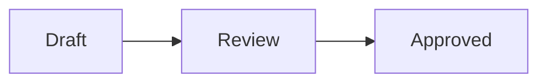

## Mermaid を PDF に変換

Mermaid コードをエディターに貼り付けるか、`.mmd` ファイルをエディターにドロップするか、**ファイルを開く** を選択します。 Markdown ドキュメントからコードフェンスで囲まれた `mermaid` ブロックを1つを貼り付けることもできます。プレビューを確認し、ページ サイズを選択し、**PDF をダウンロード** を選択します。図と PDF はブラウザで生成されます。

フローチャートで試してみるには、**サンプルを読み込む** を選択するか、この承認フローを貼り付けます。手順は左から右へ並びます。

## 共有または印刷するページ サイズを選択します

**図に合わせる** では、1 つの PDF ページが図全体に合わせたサイズになります。余白のある標準ページ内に図を収めるには、**A4** または **US Letter** を選択します。幅広の図ではページが横向きになります。大きなフローチャートは用紙に合わせるとラベルが小さくなることがあるため、読者が画面上で PDF を表示して拡大する場合は、**図に合わせる** を使用してください。

## ベクター PDF または SVG

PDF では図のベクトル形状が保持されるため、高ズーム時にも線と矢印が鮮明に保たれます。レポート、配布資料、または添付ファイルとして使用します。 **SVG** をダウンロードして、図を Web ページに埋め込むか、ベクターエディターで開きます。後で図を更新できるように、元の Mermaid コードを保存しておきます。通常の編集や PNG 書き出しには[Mermaid プレビューアー](../mermaid-previewer/)をご利用ください。

PDF ではラベルの文字をベクターの輪郭として保存します。文字をコピーしたり編集したりするときは、元のファイルを使ってください。

## レンダリングされない図を修正する

`flowchart LR` や `sequenceDiagram` などのダイアグラム宣言から始めます。コードが Markdown からのものである場合は、Mermaid ブロックを単独で貼り付けます。レンダリングが失敗してもコンバーターはコードを保持するため、構文を修正して再試行できます。その他の図の種類については、[Mermaid 構文リファレンス](https://mermaid.js.org/intro/syntax-reference.html) を参照してください。
