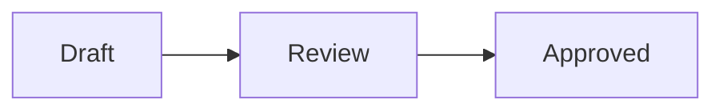

## Mermaid를 PDF로 변환

Mermaid 코드를 편집기에 붙여넣거나, `.mmd` 파일을 그 위에 놓거나, **파일 열기**를 선택하세요. Markdown 문서에서 코드 펜스로 둘러싸인 `mermaid` 블록 하나을 붙여넣을 수도 있습니다. 미리보기를 확인하고 페이지 크기를 선택한 다음 **PDF 다운로드**를 선택하세요. 다이어그램과 PDF가 브라우저에 생성됩니다.

순서도로 시도하려면 **예제 불러오기**를 선택하거나 이 승인 흐름을 붙여넣으세요. 단계는 왼쪽에서 오른쪽으로 배치됩니다.

## 공유 또는 인쇄할 페이지 크기를 선택하세요

**다이어그램에 맞추기**는 하나의 PDF 페이지를 전체 다이어그램 크기에 맞게 만듭니다. 여백이 있는 표준 페이지 내부에 다이어그램을 맞추려면 **A4** 또는 **US Letter**를 선택합니다. 넓은 다이어그램의 경우 페이지가 가로 방향으로 전환됩니다. 큰 순서도는 종이에 맞추면 작은 레이블이 있을 수 있으므로 독자가 화면에서 PDF를 보고 확대할 때 **다이어그램에 맞추기**를 사용하세요.

## 벡터 PDF 또는 SVG

PDF는 다이어그램의 벡터 모양을 유지하므로 크게 확대해도 선과 화살표가 선명하게 유지됩니다. 보고서, 유인물 또는 첨부 파일로 사용하세요. 웹페이지에 다이어그램을 삽입하거나 벡터 편집기에서 열려면 **SVG**를 다운로드하세요. 나중에 다이어그램을 업데이트하려면 원본 Mermaid 코드를 유지하세요. 일반 편집 및 PNG 내보내기를 위해서는 [Mermaid 미리보기](../mermaid-previewer/)를 사용하세요.

라벨은 벡터 윤곽선으로 저장됩니다. 라벨 텍스트를 복사하거나 편집하려면 원본 파일을 사용하세요.

## 렌더링되지 않는 다이어그램 수정

`flowchart LR` 또는 `sequenceDiagram`와 같은 다이어그램 선언으로 시작하세요. 코드가 Markdown에서 제공된 경우 Mermaid 블록만 붙여넣습니다. 변환기는 렌더링이 실패할 때 코드를 유지하므로 구문을 수정하고 다시 시도할 수 있습니다. 더 많은 다이어그램 유형은 [Mermaid 구문 참조](https://mermaid.js.org/intro/syntax-reference.html)를 참조하세요.
