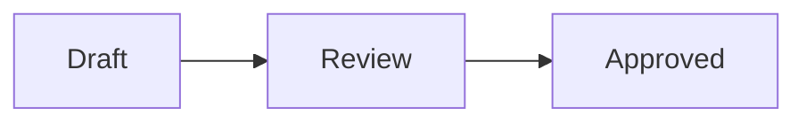

## Tukar Mermaid kepada PDF

Tampal kod Mermaid dalam penyunting, lepaskan fail `.mmd` ke dalamnya atau pilih **Buka fail**. Anda juga boleh menampal satu blok kod berpagar `mermaid` daripada dokumen Markdown. Semak pratonton, pilih saiz halaman dan pilih **Muat turun PDF**. Rajah dan PDF dihasilkan dalam pelayar anda.

Untuk mencuba carta alir, pilih **Muatkan contoh** atau tampal aliran kelulusan di bawah. Langkah disusun dari kiri ke kanan.

## Pilih saiz halaman untuk berkongsi atau mencetak

**Muatkan mengikut rajah** menghasilkan satu halaman PDF mengikut saiz keseluruhan rajah. Pilih **A4** atau **US Letter** untuk memuatkan rajah dalam halaman bersaiz standard dengan jidar. Rajah yang lebar menggunakan orientasi landskap. Label pada carta alir besar boleh menjadi kecil apabila dimuatkan pada kertas. Gunakan **Muatkan mengikut rajah** jika pembaca akan melihat dan mengezum PDF pada skrin.

## PDF vektor atau SVG

PDF mengekalkan bentuk vektor supaya garisan dan anak panah kekal tajam pada zum tinggi. Gunakan PDF untuk laporan, bahan edaran atau lampiran. Muat turun **SVG** untuk membenamkan rajah pada halaman web atau membuka rajah dalam penyunting vektor. Simpan kod Mermaid asal untuk mengubah rajah kemudian. Gunakan [Pratonton Mermaid](../mermaid-previewer/) untuk menyunting rajah dan mengeksport PNG.

Label disimpan sebagai garis luar vektor. Gunakan fail sumber untuk menyalin atau menyunting teks label.

## Betulkan rajah yang tidak dapat dipaparkan

Mulakan dengan deklarasi rajah seperti `flowchart LR` atau `sequenceDiagram`. Jika kod diambil daripada Markdown, tampal blok Mermaid sahaja. Penukar mengekalkan kod jika rajah gagal dipaparkan, jadi anda boleh membetulkan sintaks dan mencuba lagi. Rujuk [panduan sintaks Mermaid](https://mermaid.js.org/intro/syntax-reference.html) untuk jenis rajah lain.
