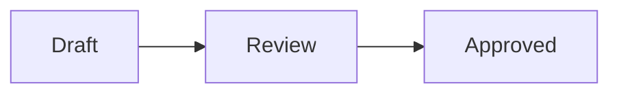

## Converteer Mermaid naar PDF

Plak Mermaid-code in de editor, sleep er een `.mmd`-bestand naartoe of kies **Bestand openen**. Je kunt ook één afgebakend `mermaid`-codeblok uit een Markdown-document plakken. Controleer de voorvertoning, kies een paginaformaat en klik op **PDF downloaden**. Het diagram en de PDF worden in je browser gemaakt.

Kies **Voorbeeld laden** of plak dit stroomdiagram voor goedkeuring. De stappen lopen van links naar rechts.

## Kies een paginaformaat om te delen of af te drukken

**Aanpassen aan diagram** maakt één pagina ter grootte van het hele diagram. Kies **A4** of **US Letter** om het diagram binnen de marges van een standaardvel te plaatsen. Brede diagrammen komen op een liggende pagina. Past een groot stroomdiagram alleen met erg kleine labels op papier? Kies **Aanpassen aan diagram** zodat de lezer op het scherm kan inzoomen.

## Vector-PDF of SVG

De PDF behoudt de vectorvormen van het diagram. Lijnen en pijlen blijven scherp als je inzoomt. Gebruik PDF voor een rapport, hand-out of bijlage. Download **SVG** om het diagram in een webpagina op te nemen of in een vectoreditor te openen. Bewaar de oorspronkelijke Mermaid-code als je het diagram later wilt aanpassen. Gebruik de [Mermaid-voorvertoner](../mermaid-previewer/) voor regelmatig bewerken en exporteren naar PNG.

Labels worden als vectorcontouren opgeslagen. Gebruik het bronbestand om de labeltekst te kopiëren of aan te passen.

## Los problemen met de weergave op

Begin met een diagramtype zoals `flowchart LR` of `sequenceDiagram`. Komt de code uit Markdown, plak dan alleen het Mermaid-blok. Bij een fout bewaart de converter je code, zodat je de syntaxis kunt corrigeren. Meer diagramtypen staan in de [Mermaid-syntaxisreferentie](https://mermaid.js.org/intro/syntax-reference.html).
