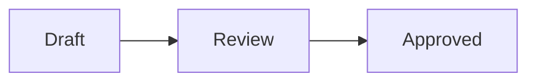

## Konverter Mermaid til PDF

Lim inn Mermaid-kode i editoren, slipp en `.mmd`-fil der eller velg **Åpne fil**. Du kan også lime inn én avgrenset `mermaid`-kodeblokk fra et Markdown-dokument. Sjekk forhåndsvisningen, velg sidestørrelse og trykk på **Last ned PDF**. Diagrammet og PDF-en lages i nettleseren.

Velg **Last inn eksempel** eller lim inn dette flytskjemaet for godkjenning. Trinnene vises fra venstre mot høyre.

## Velg sidestørrelse for deling eller utskrift

**Tilpass til diagrammet** lager én PDF-side like stor som hele diagrammet. Velg **A4** eller **US Letter** for å få diagrammet inn på ett standardark med marger. Brede diagrammer får liggende format. Hvis teksten blir for liten på papiret, bruk **Tilpass til diagrammet** slik at leseren kan zoome inn på skjermen.

## Vektor-PDF eller SVG

PDF-en beholder formene i diagrammet som vektorer, slik at linjer og piler holder seg skarpe når du zoomer inn. Bruk PDF til rapporter, utdeling eller vedlegg. Last ned **SVG** for å bygge diagrammet inn på en nettside eller åpne det i et vektorprogram. Behold Mermaid-koden hvis du vil gjøre endringer senere. Bruk [Mermaid-forhåndsviseren](../mermaid-previewer/) til vanlig redigering og eksport til PNG.

Etikettene lagres som vektorkonturer. Bruk kildefilen til å kopiere eller redigere teksten i etikettene.

## Rett opp et diagram som ikke vises

Begynn med en diagramtype som `flowchart LR` eller `sequenceDiagram`. Hvis koden kommer fra Markdown, limer du bare inn selve Mermaid-blokken. Koden blir stående ved feil, slik at du kan rette syntaksen og prøve igjen. Se [syntaksreferansen for Mermaid](https://mermaid.js.org/intro/syntax-reference.html) for flere diagramtyper.
