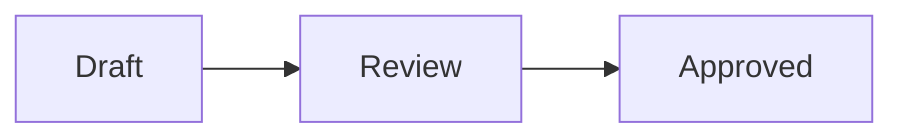

## Konwertuj Mermaid na PDF

Wklej kod Mermaid do edytora, upuść w nim plik `.mmd` lub wybierz **Otwórz plik**. Możesz też wkleić pojedynczy blok kodu `mermaid` z dokumentu Markdown wraz z ogranicznikami. Sprawdź podgląd, wybierz format strony i kliknij **Pobierz PDF**. Diagram i plik PDF powstają w przeglądarce.

Aby wypróbować schemat blokowy, wybierz **Wczytaj przykład** albo wklej poniższy proces zatwierdzania. Kroki są ułożone od lewej do prawej.

## Wybierz format strony do udostępnienia lub druku

Opcja **Dopasuj do diagramu** tworzy jedną stronę PDF o wymiarach całego diagramu. Wybierz **A4** lub **US Letter**, aby zmieścić diagram na standardowej stronie z marginesami. Szerokie diagramy mają orientację poziomą. Dopasowanie dużego schematu do kartki może zmniejszyć etykiety. Wybierz **Dopasuj do diagramu**, gdy odbiorca będzie oglądać i powiększać PDF na ekranie.

## Wektorowy PDF czy SVG

PDF zachowuje kształty wektorowe diagramu, dzięki czemu linie i strzałki pozostają ostre po powiększeniu. Użyj PDF jako raportu, materiału do rozdania lub załącznika. Pobierz **SVG**, aby osadzić diagram na stronie internetowej lub otworzyć go w edytorze wektorowym. Zachowaj kod źródłowy Mermaid, by później zmieniać diagram. Do edycji i eksportu PNG użyj narzędzia [Podgląd Mermaid](../mermaid-previewer/).

Etykiety są zapisywane jako kontury wektorowe. Aby skopiować lub zmienić ich tekst, użyj pliku źródłowego.

## Popraw diagram, który się nie wyświetla

Zacznij od deklaracji typu diagramu, np. `flowchart LR` lub `sequenceDiagram`. Jeśli kod pochodzi z Markdown, wklej sam blok Mermaid. Konwerter zachowuje kod po błędzie, więc możesz poprawić składnię i spróbować ponownie. Pozostałe typy diagramów znajdziesz w [dokumentacji składni Mermaid](https://mermaid.js.org/intro/syntax-reference.html).
