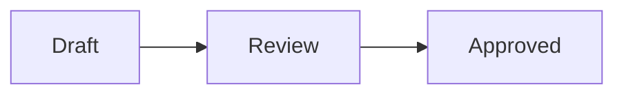

## Converter Mermaid para PDF

Cole o código Mermaid no editor, solte um arquivo `.mmd` nele ou escolha **Abrir arquivo**. Você também pode colar um único bloco de código `mermaid` de um documento Markdown. Confira a prévia, selecione um tamanho de página e clique em **Baixar PDF**. O diagrama e o PDF são gerados no navegador.

Escolha **Carregar um exemplo** ou cole este fluxo de aprovação. As etapas aparecem da esquerda para a direita.

## Escolher um tamanho de página para compartilhar ou imprimir

**Ajustar ao diagrama** cria uma página do tamanho do diagrama completo. Escolha **A4** ou **Carta (EUA)** para encaixá-lo em uma folha padrão com margens. Diagramas largos ficam na orientação paisagem. Se as legendas ficarem pequenas demais no papel, use **Ajustar ao diagrama** para permitir a leitura com zoom na tela.

## PDF vetorial ou SVG

O PDF preserva as formas vetoriais do diagrama. Assim, as linhas e setas ficam nítidas mesmo com zoom alto, o que é útil para relatórios, materiais impressos e anexos. Baixe o **SVG** para incorporar o diagrama a uma página da web ou abri-lo em um editor vetorial. Guarde o código Mermaid para fazer alterações depois. Para editar com frequência ou exportar em PNG, use o [Pré-visualizador de Mermaid](../mermaid-previewer/).

Os rótulos são salvos como contornos vetoriais. Use o arquivo de origem para copiar ou editar o texto dos rótulos.

## Corrigir um diagrama que não aparece

Comece com uma declaração como `flowchart LR` ou `sequenceDiagram`. Se o código veio de um documento Markdown, cole apenas o bloco Mermaid. Se o diagrama não aparecer, o conversor mantém o código no editor para você corrigir a sintaxe. Consulte a [referência de sintaxe do Mermaid](https://mermaid.js.org/intro/syntax-reference.html) para conhecer outros tipos de diagrama.
