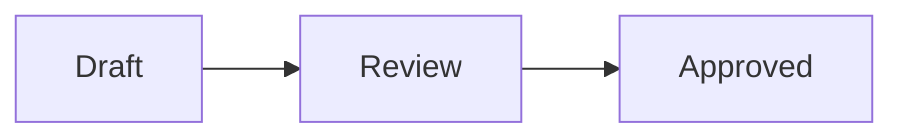

## Преобразуйте диаграмму Mermaid в PDF

Вставьте код Mermaid в редактор, перетащите туда файл `.mmd` или нажмите **Открыть файл**. Также можно вставить один блок кода `mermaid` из документа Markdown вместе с ограничителями. Проверьте предпросмотр, выберите формат страницы и нажмите **Скачать PDF**. Диаграмма и PDF создаются в браузере.

Чтобы попробовать блок-схему, нажмите **Загрузить пример** или вставьте код процесса согласования ниже. Его шаги расположены слева направо.

## Выберите формат страницы для просмотра или печати

**По размеру диаграммы** создаёт одну страницу PDF, на которой целиком помещается диаграмма. Выберите **A4** или **US Letter**, чтобы разместить её на стандартном листе с полями. Для широких диаграмм используется альбомная ориентация. При подгонке большой блок-схемы под размер листа подписи могут стать мелкими. Если получатель будет просматривать и увеличивать PDF на экране, выберите **По размеру диаграммы**.

## Векторный PDF или SVG

PDF сохраняет векторные фигуры диаграммы, поэтому линии и стрелки остаются чёткими при увеличении. Используйте PDF для отчёта, раздаточного материала или вложения. Скачайте **SVG**, чтобы встроить диаграмму в веб-страницу или открыть её в векторном редакторе. Сохраните исходный код Mermaid для дальнейшего редактирования. Для редактирования и экспорта в PNG воспользуйтесь [предпросмотром Mermaid](../mermaid-previewer/).

Подписи сохраняются в виде векторных контуров. Чтобы скопировать или изменить текст подписи, используйте исходный файл.

## Исправьте ошибку построения диаграммы

Начните с объявления типа диаграммы, например `flowchart LR` или `sequenceDiagram`. Если код взят из Markdown, вставьте только блок Mermaid. После ошибки код остаётся в конвертере, и вы можете исправить синтаксис и повторить попытку. Другие типы диаграмм описаны в [справочнике по синтаксису Mermaid](https://mermaid.js.org/intro/syntax-reference.html).
