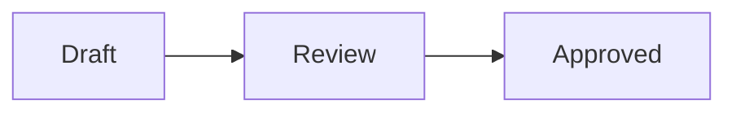

## Konvertera Mermaid till PDF

Klistra in Mermaid-kod i redigeraren, släpp en `.mmd`-fil där eller välj **Öppna fil**. Du kan också klistra in ett enskilt avgränsat `mermaid`-kodblock från ett Markdown-dokument. Kontrollera förhandsvisningen, välj sidstorlek och klicka på **Ladda ned PDF**. Diagrammet och PDF-filen skapas i webbläsaren.

Välj **Ladda exempel** eller klistra in det här flödesschemat för godkännande. Stegen visas från vänster till höger.

## Välj sidstorlek för delning eller utskrift

**Anpassa till diagrammet** skapar en PDF-sida lika stor som hela diagrammet. Välj **A4** eller **US Letter** så att diagrammet får plats på ett standardark med marginaler. Breda diagram får liggande format. Om etiketterna blir för små på papper kan du välja **Anpassa till diagrammet** så att läsaren kan zooma in på skärmen.

## Vektor-PDF eller SVG

PDF-filen bevarar diagrammets vektorformer. Linjer och pilar förblir skarpa när du zoomar in. PDF passar exempelvis för rapporter, utdelningsmaterial och bilagor. Ladda ned **SVG** för att bädda in diagrammet på en webbsida eller öppna det i en vektorredigerare. Spara Mermaid-koden om du vill ändra den senare. Använd [Mermaid-förhandsgranskaren](../mermaid-previewer/) för löpande redigering och export till PNG.

Etiketterna sparas som vektorkonturer. Använd källfilen om du vill kopiera eller redigera etiketternas text.

## Felsök ett diagram som inte visas

Börja med en diagramtyp som `flowchart LR` eller `sequenceDiagram`. Om koden kommer från ett Markdown-dokument, klistra in enbart Mermaid-blocket. Koden finns kvar om renderingen misslyckas, så att du kan rätta syntaxen. Se [Mermaids syntaxreferens](https://mermaid.js.org/intro/syntax-reference.html) för fler diagramtyper.
