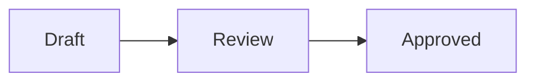

## แปลง Mermaid เป็น PDF

วางโค้ด Mermaid ลงในโปรแกรมแก้ไข วางไฟล์ `.mmd` ลงไป หรือเลือก **เปิดไฟล์** คุณยังสามารถวางบล็อกโค้ด `mermaid` หนึ่งบล็อกที่มีเครื่องหมายครอบจากเอกสาร Markdown ได้อีกด้วย ตรวจสอบตัวอย่าง เลือกขนาดหน้า และเลือก **ดาวน์โหลด PDF** ไดอะแกรมและ PDF ถูกสร้างขึ้นในเบราว์เซอร์ของคุณ

หากต้องการลองใช้ผังงาน ให้เลือก **โหลดตัวอย่าง** หรือวางขั้นตอนการอนุมัตินี้ โดยจะเรียงขั้นตอนจากซ้ายไปขวา

## เลือกขนาดหน้าสำหรับการแชร์หรือการพิมพ์

**พอดีกับแผนภาพ** ทำให้หน้า PDF หนึ่งหน้ามีขนาดเท่ากับไดอะแกรมทั้งหมด เลือก **A4** หรือ **US Letter** เพื่อให้พอดีกับไดอะแกรมภายในหน้ามาตรฐานที่มีระยะขอบ หน้าจะเปลี่ยนเป็นแนวนอนสำหรับไดอะแกรมแบบกว้าง ผังงานขนาดใหญ่อาจมีป้ายกำกับขนาดเล็กเมื่อพอดีกับกระดาษ ดังนั้นให้ใช้ **พอดีกับแผนภาพ** เมื่อผู้อ่านจะดู PDF บนหน้าจอและซูมเข้า

## เวกเตอร์ PDF หรือ SVG

PDF จะรักษารูปร่างเวกเตอร์ของไดอะแกรม เพื่อให้เส้นและลูกศรคงความคมชัดเมื่อซูมสูง ใช้สำหรับรายงาน เอกสารประกอบคำบรรยาย หรือเอกสารแนบ ดาวน์โหลด **SVG** เพื่อฝังไดอะแกรมในหน้าเว็บหรือเปิดในโปรแกรมแก้ไขเวกเตอร์ เก็บโค้ด Mermaid ต้นฉบับไว้เพื่ออัปเดตไดอะแกรมในภายหลัง สำหรับการแก้ไขและส่งออก PNG เป็นประจำ ให้ใช้ [โปรแกรมดูตัวอย่าง Mermaid](../mermaid-previewer/)

ป้ายกำกับจะถูกบันทึกเป็นเส้นขอบเวกเตอร์ หากต้องการคัดลอกหรือแก้ไขข้อความ ให้ใช้ไฟล์ต้นฉบับ

## แก้ไขไดอะแกรมที่ไม่เรนเดอร์

เริ่มต้นด้วยการประกาศไดอะแกรม เช่น `flowchart LR` หรือ `sequenceDiagram` หากโค้ดมาจาก Markdown ให้วางเฉพาะบล็อก Mermaid ตัวแปลงจะเก็บโค้ดของคุณไว้เมื่อการเรนเดอร์ล้มเหลว คุณจึงสามารถแก้ไขไวยากรณ์และลองอีกครั้งได้ ดู [การอ้างอิงไวยากรณ์ Mermaid](https://mermaid.js.org/intro/syntax-reference.html) สำหรับประเภทไดอะแกรมเพิ่มเติม
