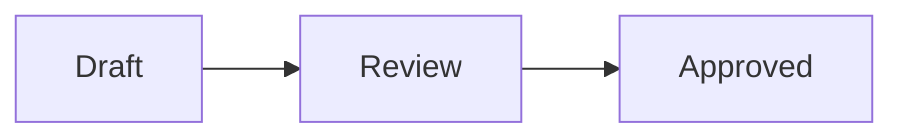

## Mermaid diyagramını PDF’ye dönüştürün

Mermaid kodunu düzenleyiciye yapıştırın, bir `.mmd` dosyasını düzenleyiciye bırakın veya **Dosya aç** seçeneğini kullanın. Markdown belgesinden, sınırlayıcılarıyla birlikte tek bir `mermaid` kod bloğu da yapıştırabilirsiniz. Önizlemeyi kontrol edin, sayfa boyutunu seçin ve **PDF indir** düğmesine tıklayın. Diyagram ve PDF tarayıcınızda oluşturulur.

Akış şemasını denemek için **Örnek yükle** seçeneğini kullanın veya aşağıdaki onay akışı kodunu yapıştırın. Adımlar soldan sağa sıralanır.

## Paylaşım veya baskı için sayfa boyutunu seçin

**Diyagrama göre**, tüm diyagramın boyutunda tek bir PDF sayfası oluşturur. Diyagramı kenar boşluklarıyla standart bir sayfaya sığdırmak için **A4** veya **US Letter** seçin. Geniş diyagramlar için yatay sayfa kullanılır. Büyük akış şemalarını kâğıda sığdırmak etiketleri küçültebilir. PDF’yi ekranda inceleyip yakınlaştıracak kişiler için **Diyagrama göre** seçeneğini kullanın.

## Vektörel PDF veya SVG

PDF, diyagramdaki vektör şekillerini korur. Çizgiler ve oklar yüksek büyütme oranlarında da net kalır. Rapor, basılı materyal veya dosya eki için PDF kullanın. Diyagramı web sayfasına yerleştirmek veya vektör düzenleyicide açmak için **SVG** indirin. Daha sonra diyagramı değiştirmek için özgün Mermaid kodunu saklayın. Düzenleme ve PNG dışa aktarımı için [Mermaid Önizleyici](../mermaid-previewer/) aracını kullanın.

Etiketler vektör ana hatları olarak kaydedilir. Etiket metnini kopyalamak veya düzenlemek için kaynak dosyayı kullanın.

## Görüntülenmeyen bir diyagramı düzeltin

`flowchart LR` veya `sequenceDiagram` gibi bir diyagram türü bildirimiyle başlayın. Kod Markdown’dan geldiyse yalnızca Mermaid bloğunu yapıştırın. Oluşturma başarısız olsa da kodunuz kalır, böylece söz dizimini düzeltip yeniden deneyebilirsiniz. Diğer diyagram türleri için [Mermaid söz dizimi kılavuzuna](https://mermaid.js.org/intro/syntax-reference.html) bakın.
