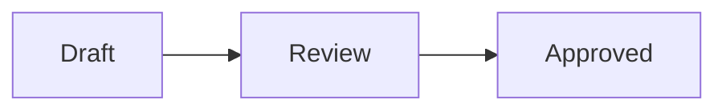

## Chuyển sơ đồ Mermaid sang PDF

Dán mã Mermaid vào trình chỉnh sửa, thả tệp `.mmd` vào đó hoặc chọn **Mở tệp**. Bạn cũng có thể dán một khối mã `mermaid` từ tài liệu Markdown, kèm dấu mở và đóng khối. Kiểm tra phần xem trước, chọn khổ trang rồi chọn **Tải PDF xuống**. Sơ đồ và tệp PDF được tạo ngay trong trình duyệt.

Để thử với một lưu đồ, hãy chọn **Tải ví dụ** hoặc dán mã quy trình phê duyệt dưới đây. Các bước được bố trí từ trái sang phải.

## Chọn khổ trang để chia sẻ hoặc in

**Vừa sơ đồ** tạo một trang PDF có kích thước vừa với toàn bộ sơ đồ. Chọn **A4** hoặc **US Letter** để căn sơ đồ vừa trang giấy tiêu chuẩn có chừa lề. Sơ đồ rộng dùng trang ngang. Nhãn trên lưu đồ lớn có thể bị thu nhỏ khi căn vừa khổ giấy. Chọn **Vừa sơ đồ** nếu người nhận sẽ xem và phóng to PDF trên màn hình.

## Chọn PDF vectơ hay SVG

PDF giữ lại hình dạng vectơ của sơ đồ để đường nét và mũi tên vẫn sắc nét khi phóng to. Dùng PDF cho báo cáo, tài liệu phát tay hoặc tệp đính kèm. Tải **SVG** để nhúng sơ đồ vào trang web hoặc mở trong trình chỉnh sửa vectơ. Giữ mã Mermaid gốc để chỉnh sửa sơ đồ sau này. Để chỉnh sửa và xuất PNG, hãy dùng [Trình xem trước Mermaid](../mermaid-previewer/).

Nhãn được lưu dưới dạng đường viền vectơ. Dùng tệp nguồn để sao chép hoặc chỉnh sửa văn bản của nhãn.

## Sửa sơ đồ không kết xuất được

Bắt đầu bằng dòng khai báo loại sơ đồ như `flowchart LR` hoặc `sequenceDiagram`. Nếu lấy mã từ Markdown, chỉ dán riêng khối Mermaid. Khi kết xuất lỗi, mã vẫn được giữ lại để bạn sửa cú pháp và thử lại. Xem [tài liệu cú pháp Mermaid](https://mermaid.js.org/intro/syntax-reference.html) để tìm hiểu các loại sơ đồ khác.
