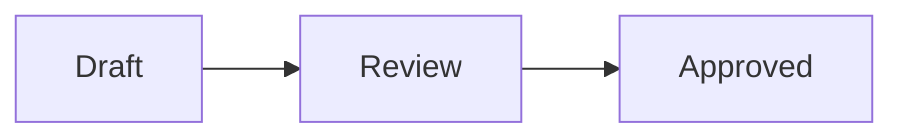

## 將 Mermaid 轉成 PDF

把 Mermaid 程式碼貼到編輯器，或拖入 `.mmd` 檔案。也可以選擇**開啟檔案**，或從 Markdown 文件複製一整段以反引號框住的 `mermaid` 程式碼區塊。確認預覽後，選擇頁面尺寸，再按**下載 PDF**。圖表和 PDF 都在瀏覽器中產生。

想快速試用，可選擇**載入範例**，或貼上下方從左到右排列的審核流程。

## 依分享或列印需求選擇頁面尺寸

**依圖表尺寸**會產生一頁剛好容納完整圖表的 PDF。選擇 **A4** 或 **US Letter** 時，工具會保留邊界，將整張圖縮放到一頁內，較寬的圖會採用橫向。如果流程很複雜，縮放到一張紙後文字可能偏小。主要在螢幕上閱讀時，可以選**依圖表尺寸**，方便放大查看。

## 向量 PDF 和 SVG 各適合哪些用途

向量 PDF 適合放入報告、講義或電子郵件附件，放大後線條和箭頭依然清楚。要嵌入網頁或在向量編輯器中調整，可下載 **SVG**。請保留 Mermaid 原始程式碼，方便日後修改圖表。需要即時編輯或匯出 PNG 時，可使用 [Mermaid 預覽器](../mermaid-previewer/)。

PDF 會把文字標籤儲存為向量外框。若要複製或修改標籤文字，請使用原始檔。

## 圖表無法顯示時怎麼辦

請確認第一行是否宣告了圖表類型，例如 `flowchart LR` 或 `sequenceDiagram`。從 Markdown 複製時，只貼上 Mermaid 程式碼區塊。產生預覽失敗時，編輯器會保留原本的程式碼，修正後即可重試。其他圖表類型可參閱 [Mermaid 語法參考](https://mermaid.js.org/intro/syntax-reference.html)。
